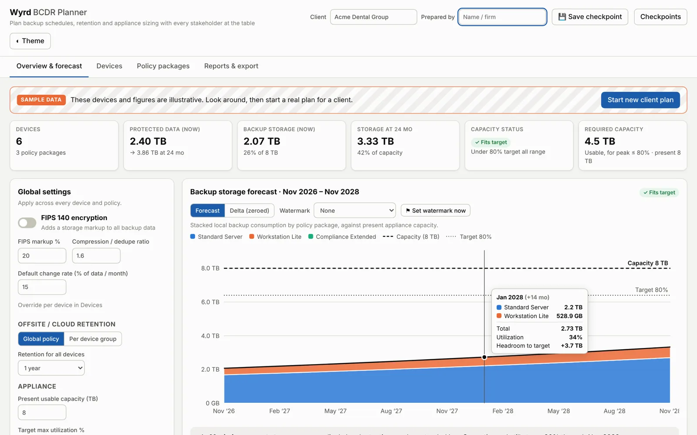
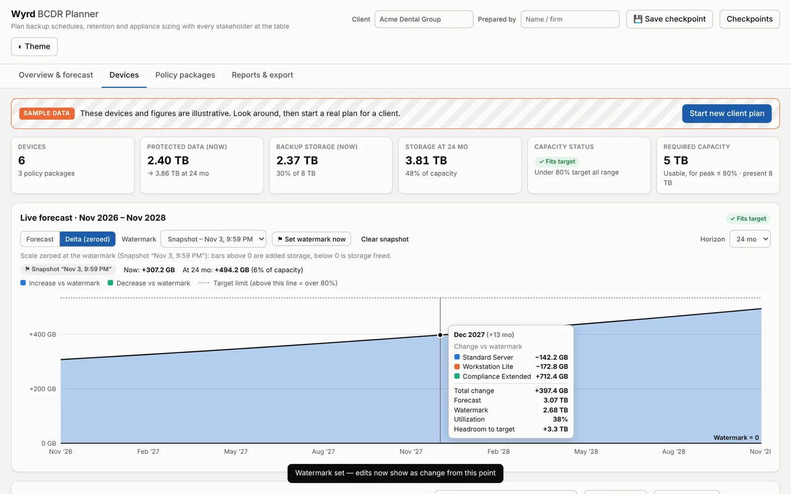
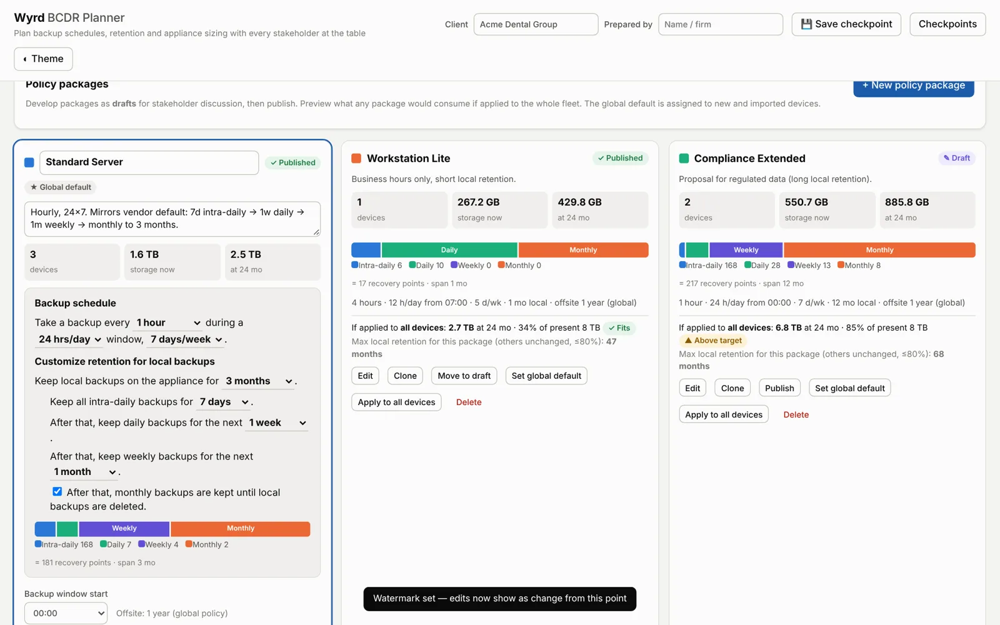
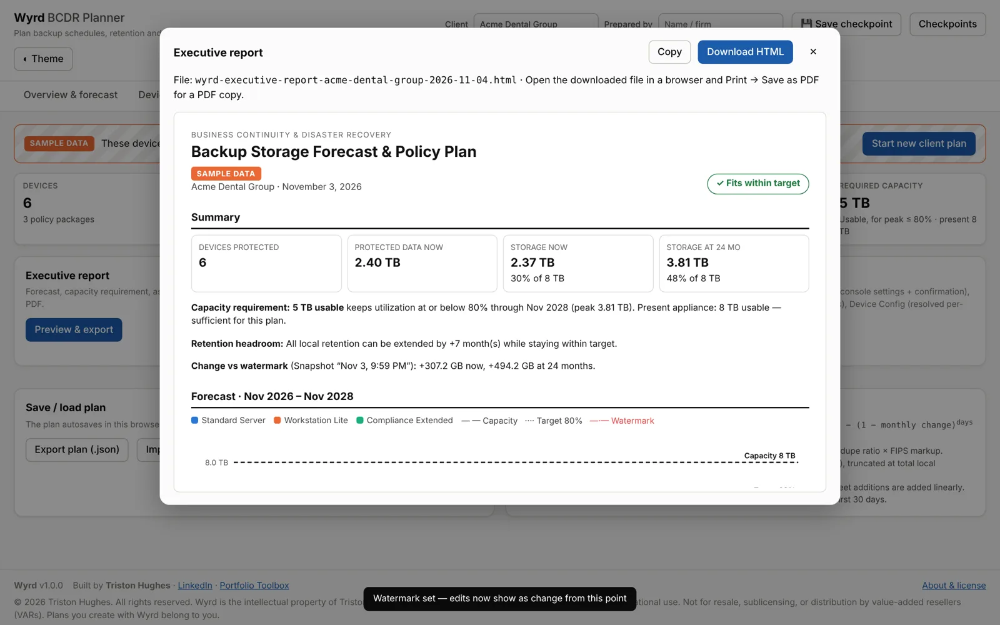

# Wyrd — BCDR Planner

**Plan backup schedules, retention and BCDR appliance sizing with every stakeholder at the table, then hand the technician a workbook to deploy it.**

Wyrd is a single HTML file. It needs no installation and no server. Open it in any modern browser, add a client's devices, build backup policy packages, and see what each choice costs in local storage across the next months or years. You can check whether the present appliance holds the plan, how much retention it can afford, and what capacity a replacement needs.

### ▶ [Launch Wyrd in your browser](https://caitous.github.io/Wyrd-BCDR-Planner/) &nbsp;·&nbsp; ⬇ [Download the latest release](https://github.com/CAITOUS/Wyrd-BCDR-Planner/releases/latest)

No sign-up and no install. It opens on clearly labeled **sample data** so you can look around right away. Click **Start new client plan** to clear the devices and begin a real one. Your plan is saved in your own browser only.



---

## What it does

- **Devices.** Add devices by hand or import an RMM / CSV export. Edit inline, filter, sort, and mass-edit selected rows: policy, type, site, change rate, growth, custom retention.
- **Policy packages.** Build backup schedules and local retention tiers (intra-daily → daily → weekly → monthly) in plain sentences, at regular intervals. Develop packages as **drafts** for discussion, publish them, clone them, and set a global default. Each package shows what it would use if applied to the whole fleet and the longest retention it could afford.
- **Per-device retention.** Override any device's schedule or retention without changing its policy, and apply the override to one device, the selection, or everyone on that policy.
- **Global settings.** FIPS encryption (adds a storage markup, 20% by default), compression/dedupe ratio, change rate as % of data per month, and offsite/cloud retention as one global policy or per device group.
- **Forecasting.** Monthly forecast over a range you set (start month and horizon), with data growth as % or GB per month, globally or per device, plus planned fleet additions. Stacked chart by policy against capacity and target, with a table view.
- **Watermark & delta.** Set a watermark, make changes, and switch to **Delta (zeroed)** to see exactly how much storage a change adds or frees. The live forecast sits on the Devices tab too, so edits show their effect as you make them.
- **Capacity answers.** Required usable capacity to stay under your target, the month the present appliance hits target or fills, and how many months of retention every policy can gain or must lose.
- **Checkpoints.** Save the whole configuration under a name, star one as **preferred**, and return to it in one click.
- **Executive report.** Self-contained HTML with summary figures, forecast chart and table, policy table, assumptions, and the risks and decisions needed. Prints cleanly to PDF.
- **Technician workbook (.xlsx).** Read Me, Policy Breakdown (console settings with confirmation cells), Groupings (by policy, by site, and a site × policy matrix), Inventory (yellow fill-in cells with dropdowns), Device Config (final settings per device), Overrides, and a Sign-off checklist. Draft policies are flagged *do not deploy*.

| | |
|---|---|
|  |  |
|  | |

---

## Quick start

1. **Open Wyrd**, either way:
   - **In your browser:** [caitous.github.io/Wyrd-BCDR-Planner](https://caitous.github.io/Wyrd-BCDR-Planner/). Nothing to download.
   - **Offline copy:** download `Wyrd.html` (app only) or `wyrd-<version>.zip` (app, guides, license) from [Releases](https://github.com/CAITOUS/Wyrd-BCDR-Planner/releases/latest), then open `Wyrd.html`.
2. **Click Start new client plan.** This clears the sample devices and keeps the starter policy packages.
3. **Enter the client name** and the present appliance's usable capacity.
4. **Add or import devices** on the Devices tab, and assign each to a policy package.
5. **Adjust policies and global settings** with stakeholders. Set a watermark first to see the change each decision makes.
6. **Save a checkpoint** once the plan is agreed, and star it as preferred.
7. **Export** the executive report for decision makers and the technician workbook for deployment.

---

## How accurate is it?

Wyrd gives planning estimates, not vendor quotes. Each retained recovery point is modeled as storing the data that changed over its span, using the monthly change rate, then reduced by the compression/dedupe ratio and increased by the FIPS markup. Real consumption depends on the backup product, the workload and how data changes. Validate the forecast against appliance-reported usage after the first 30 days and adjust the change rate and ratio to match.

---

## Repository contents

```
Wyrd.html              The app (single file)
index.html             Opens Wyrd.html when the site is visited (GitHub Pages)
.nojekyll              Serve files as-is on GitHub Pages
wyrd.json              Version file that copies of Wyrd check for updates
.github/workflows/     Release workflow: builds the download package for each new version
docs/RELEASING.md      How to publish a new version
docs/images/           Screenshots used in this README
CHANGELOG.md           Version history
LICENSE.md             License terms
```

## Requirements

- Any current browser: Chrome, Edge, Brave, Firefox or Safari.
- Works offline. Fonts load from Google Fonts when online and fall back to system fonts otherwise. The technician workbook needs a connection the first time it's built in a session (it loads ExcelJS from cdnjs).
- Nothing is sent anywhere. Plans and checkpoints are saved in your browser's local storage only. Use **Export plan** to move a plan between browsers or share it.

---

## License

© 2026 Triston Hughes. All rights reserved. Free for personal, educational and internal organizational use. Not for resale, sublicensing or distribution by value-added resellers. See [LICENSE.md](LICENSE.md).

Built by **Triston Hughes** · [LinkedIn](https://www.linkedin.com/in/triston-hughes-949420242/) · [Portfolio Toolbox](https://triston-hughes.vercel.app/)
